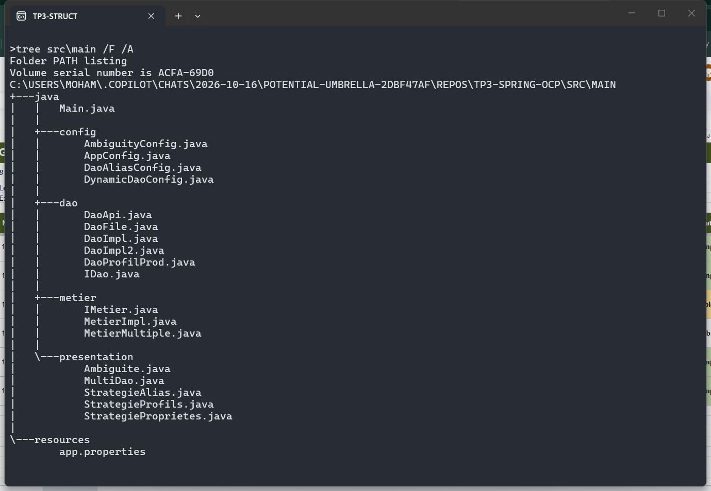
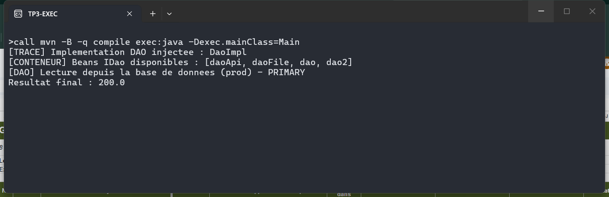
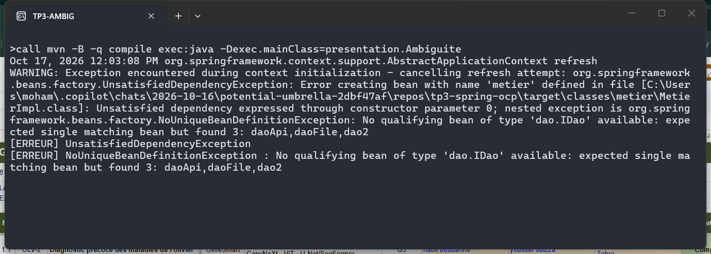
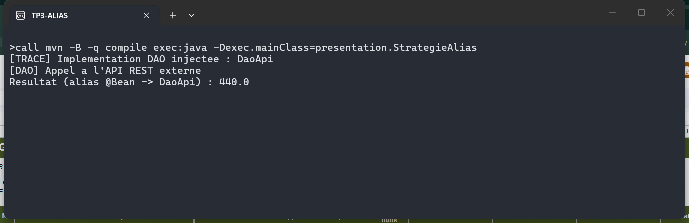
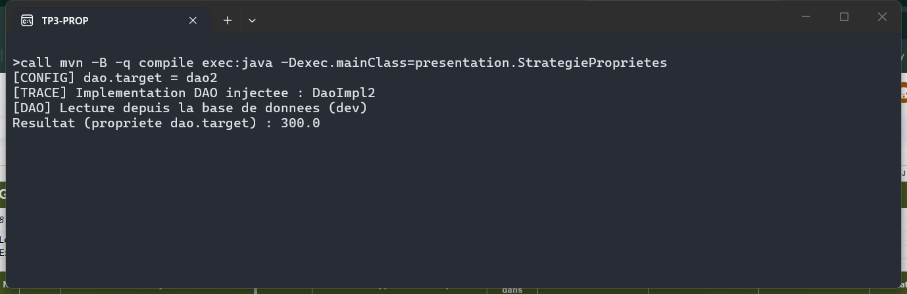
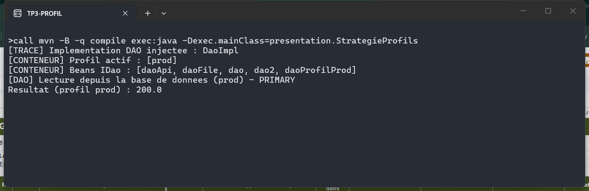
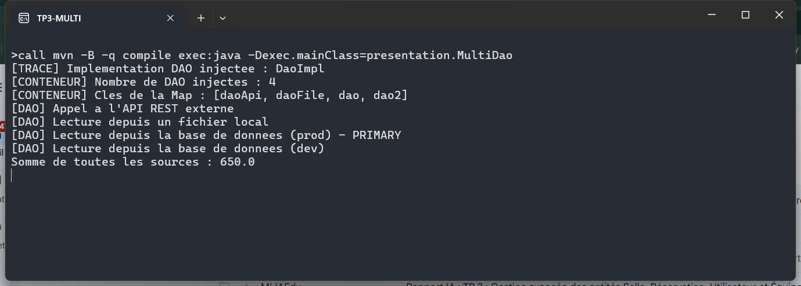
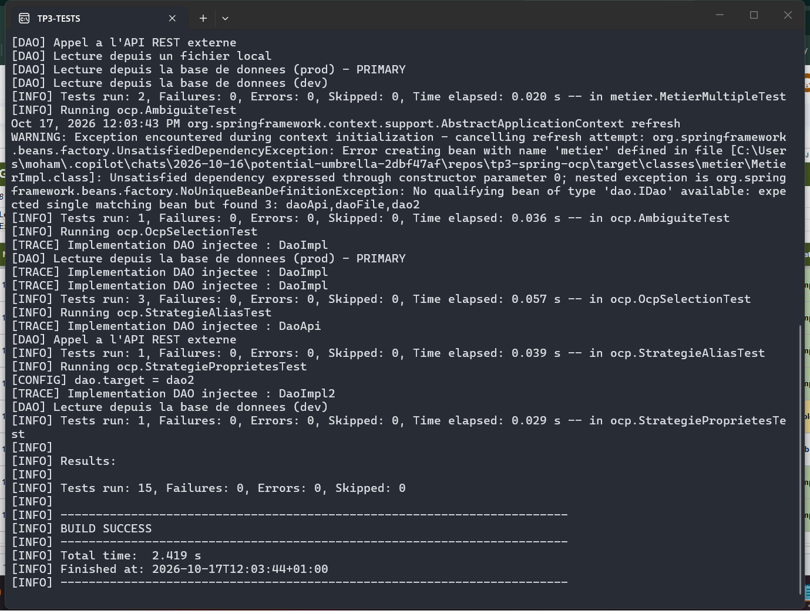

# TP 3 : Spring IoC & OCP — Stratégies d'injection et sélection d'implémentations

Le principe Ouvert/Fermé (OCP) impose de pouvoir changer de source de données **sans jamais modifier `MetierImpl`**.
Toute la logique de sélection est externalisée dans la configuration Spring.

## Structure du projet : packages `dao`, `metier`, `config` et point d'entrée `Main`

## Stratégie A — `@Primary` : `DaoImpl` est choisie par défaut → `Resultat final = 200.0`

## Le problème de l'ambiguïté : sans `@Primary`, Spring lève `NoUniqueBeanDefinitionException` (3 candidats)

## Stratégie B — alias `@Bean @Primary` : le conteneur pointe vers `DaoApi` → `Resultat = 440.0`

## Stratégie C — propriété externe `dao.target=dao2` lue par `@Value` → `Resultat = 300.0`

## Profils Spring : le profil `prod` enregistre `daoProfilProd` (5 beans `IDao` au lieu de 4)

## Injection multiple : `List<IDao>` et `Map<String, IDao>` — somme des 4 sources → `650.0`

## Tests de non-régression : `Tests run: 15, Failures: 0, Errors: 0` — `BUILD SUCCESS`
